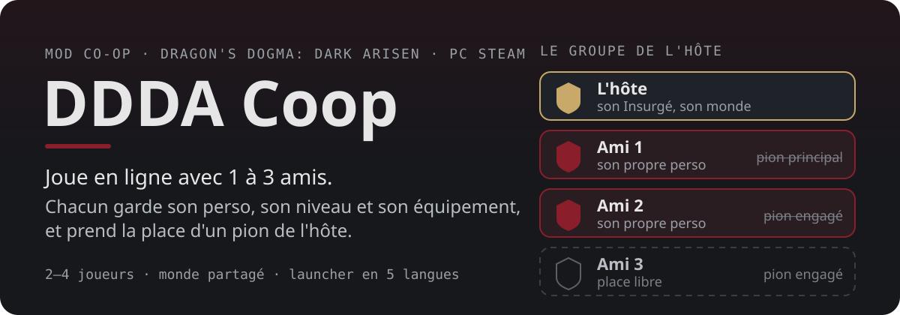
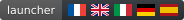
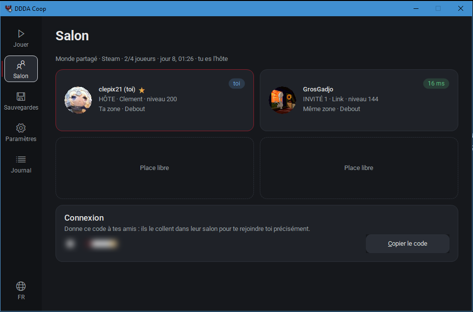
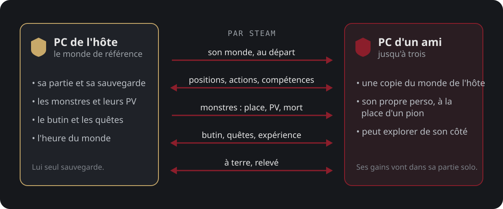

<p align="center">
  
</p>
<p align="center"><a href="README.md">English</a> · <b>Français</b></p>
<p align="center">
  <a href="https://github.com/clepix21/ddda-coop/releases/latest"><b>Télécharger</b></a> ·
  <a href="#installation">Installation</a> ·
  <a href="#jouer">Jouer</a> ·
  <a href="#bon-à-savoir">Bon à savoir</a> ·
  <a href="docs/TECHNICAL.md">Doc technique (EN)</a>
</p>

<!-- badges: work/readme_badges.py -->
<p align="center">
  
  
  
  
<br>
  
  
  
<br>
  
  
  <a href="LICENSE"></a>
</p>
<!-- /badges -->

<p align="center">
  
  <br><sub>Le salon pendant une vraie partie.</sub>
</p>

<p align="center">
  
  
  
</p>
<p align="center">
  
  
  
</p>
<p align="center"><sub>Enregistré pendant une vraie partie à deux (Bitterblack Isle).</sub></p>

## En bref

L'hôte joue sa partie comme d'habitude. Jusqu'à trois amis Steam le rejoignent, chacun sur son PC et
avec **son propre perso** (apparence, vocation, niveau, équipement) qui prend la place d'un pion.
Monstres, butin, quêtes et expérience sont partagés. Ce que ton perso gagne chez un ami revient dans ta
partie solo.

## Comment ça marche

<p align="center">
  
</p>

Seul l'hôte sauvegarde : la partie d'un invité n'est jamais écrasée. Chaque joueur peut aussi partir
explorer de son côté et revenir quand il veut.

## Installation

1. Télécharge `DDDA-Coop-vX.Y.Z.zip` dans les [Releases](https://github.com/clepix21/ddda-coop/releases)
   et dézippe-le où tu veux.
2. Ouvre `DDDA-Coop.exe`. Il trouve le jeu tout seul et sauvegarde tes parties avant chaque lancement.
3. Choisis ton rôle (**Hôte**, **Invité** ou **Seul**) puis clique sur **Lancer le jeu**.

Il te faut Dragon's Dogma: Dark Arisen sur **Steam** (build 2364871, la version PC actuelle). Tout le
monde doit avoir **la même version du mod** : la fenêtre te prévient sinon.

## Jouer

**L'hôte** lance le jeu et charge sa partie. Ses amis Steam qui ont le mod le rejoignent tout seuls.

**Un invité** lance le jeu et reste sur l'écran titre jusqu'à ce que la fenêtre affiche
« Connecté ! », puis appuie sur Start et charge une partie : c'est le monde de l'hôte qui arrive.

Plusieurs amis hébergent en même temps ? L'hôte ouvre **Salon** › **Copier le code**, et l'invité colle
ce code dans son propre **Salon** avant de lancer.

Les touches et les détails sont dans `README.txt` (en anglais), à l'intérieur du zip ; `HOW-TO-TEST.txt` est une courte liste pour une première partie entre amis.

## Bon à savoir

- **Après le tutoriel seulement.** La co-op démarre quand l'hôte et chaque invité ont un perso qui a
  fini le tutoriel, c'est-à-dire avec son pion principal. Sur une nouvelle partie, faites-le chacun
  seul d'abord.
- **Alpha.** Testé surtout par des bots et lors d'une soirée entre amis. Garde le « Journal détaillé »
  activé (Paramètres) pour pouvoir signaler un bug.
- Les autres joueurs peuvent encore glisser un peu quand la connexion est irrégulière (amélioré en
  0.9.2).
- Pas encore testés : la Mort (Île du Crépuscule), l'eau profonde, les longues sessions.
- Les fonctions en ligne du jeu (la Faille, les pions d'autres joueurs) ne sont pas prises en charge
  par le mod : évite-les pendant une partie en co-op.

Un bug ? Ouvre une [issue](https://github.com/clepix21/ddda-coop/issues) et joins le journal (écran
**Journal** › **Exporter le journal**).

<details>
<summary><b>Questions fréquentes</b></summary>

**Est-ce que ça touche à mes sauvegardes ?** Avant chaque lancement, la fenêtre copie tes sauvegardes
dans `Documents\DDDA Coop\Sauvegardes`. Le jeu d'un invité ne sauvegarde jamais.

**Comment revenir au jeu normal ?** **Paramètres** › **Retirer le mod**. Tu peux aussi supprimer
`dinput8.dll` et `coop.ini` du dossier du jeu.

**Ça marche hors de Steam ?** Pas pour le moment. Il existe un mode réseau local pour les tests (voir la
doc technique).

</details>

<details>
<summary><b>Compiler depuis les sources</b></summary>

Il faut Windows, [llvm-mingw](https://github.com/mstorsjo/llvm-mingw) et
[MinHook](https://github.com/TsudaKageyu/minhook) 1.3.4 :

```powershell
.\build.ps1 -Toolchain <dossier llvm-mingw> -MinHook <dossier minhook>
```

La compilation donne `build\dinput8.dll` (le mod), `build\DDDA-Coop.exe` (la fenêtre) et
`build\DDDA-Coop.zip`. Le fonctionnement et les tests automatiques sont décrits dans
[docs/TECHNICAL.md](docs/TECHNICAL.md).

</details>

## Crédits

- **clepix21** : auteur du mod.
- **GrosGadjo** et **yaybba** : testeurs.
- Développé avec l'aide de **Claude** (Anthropic).
- [MinHook](https://github.com/TsudaKageyu/minhook) (licence BSD 2-Clause) et la police
  [Roboto](https://github.com/googlefonts/roboto-3-classic) (SIL Open Font License 1.1) : leurs licences sont dans
  [dist/LICENCES.txt](dist/LICENCES.txt).

## Licence

[MIT](LICENSE) pour le code du mod. L'icône du launcher reprend un visuel de Dragon's Dogma © Capcom et n'est
pas couverte par cette licence.

<sub>Mod non officiel, sans lien avec Capcom. Dragon's Dogma: Dark Arisen © Capcom. Il te faut ta propre
copie du jeu : ce dépôt ne contient aucun fichier du jeu.</sub>
