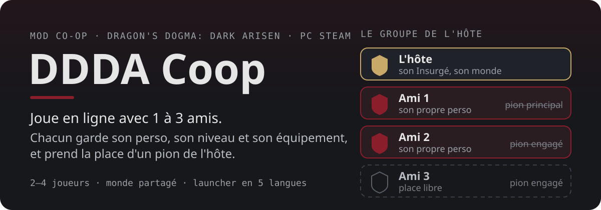
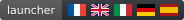
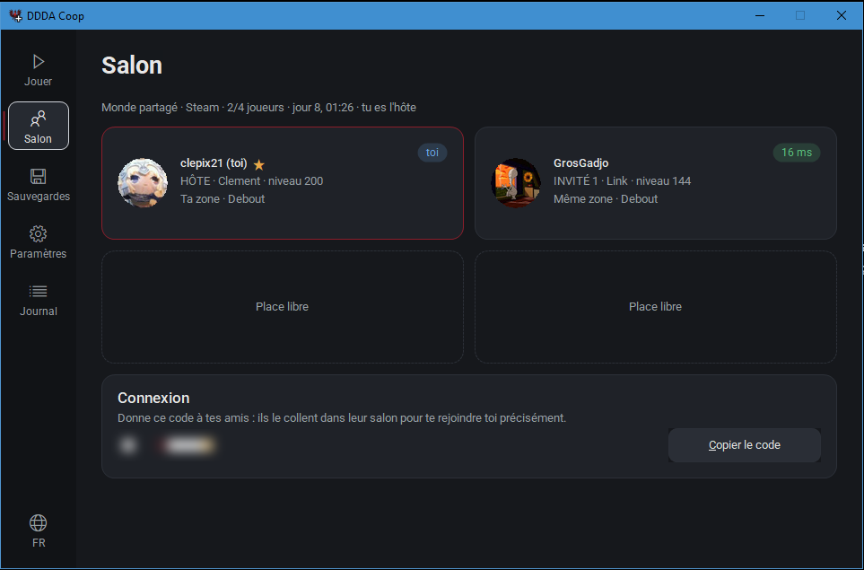
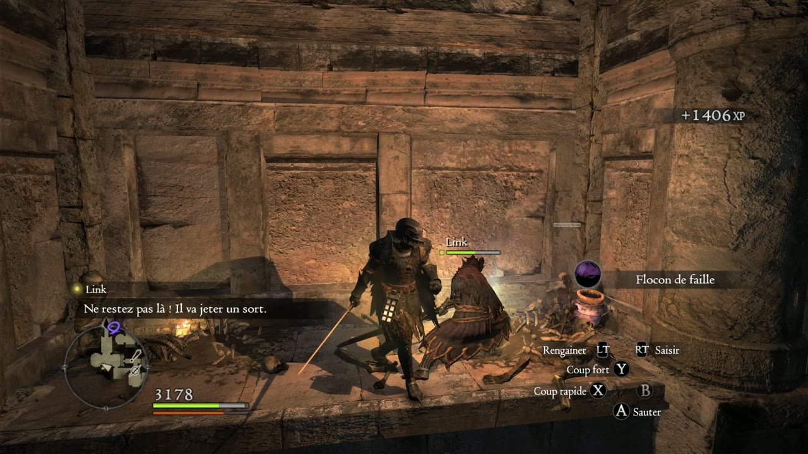
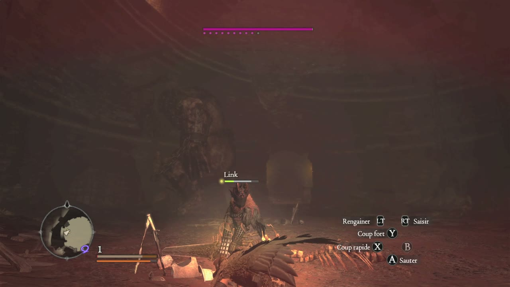
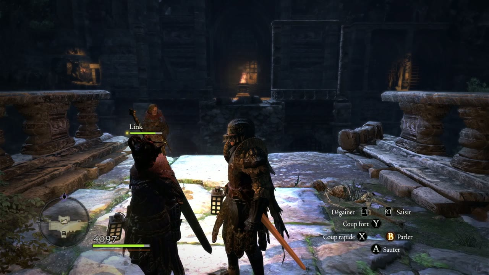
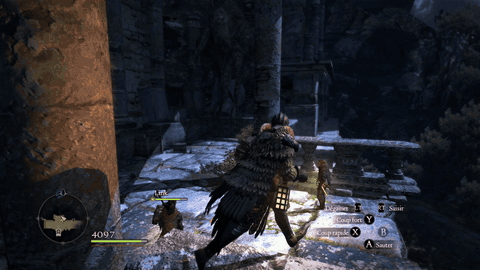
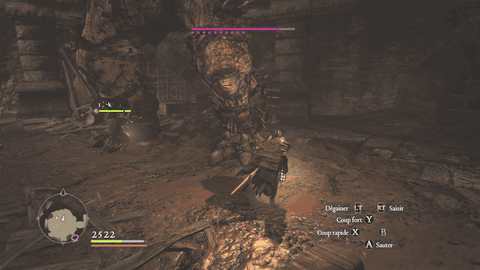
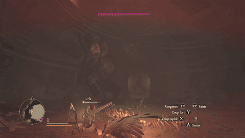
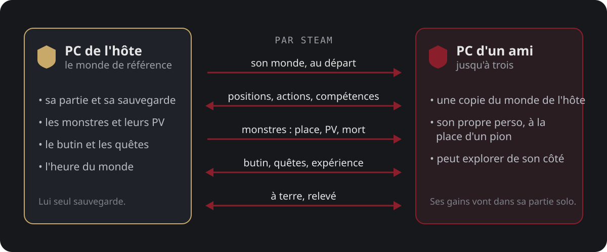

<p align="center">
  
</p>
<p align="center"><a href="README.md">English</a> · <b>Français</b></p>
<p align="center">
  <a href="https://github.com/clepix21/ddda-coop/releases/latest"><b>Télécharger</b></a> ·
  <a href="#installation">Installation</a> ·
  <a href="#jouer">Jouer</a> ·
  <a href="#bon-à-savoir">Bon à savoir</a> ·
  <a href="docs/TECHNICAL.md">Doc technique (EN)</a>
</p>

<!-- badges: work/readme_badges.py -->
<p align="center">
  
  
  <a href="https://github.com/clepix21/ddda-coop/releases"></a>
  
  
<br>
  
  
  
  
<br>
  
  
  <a href="LICENSE"></a>
</p>
<!-- /badges -->

<p align="center">
  
  <br><sub>Le salon pendant une vraie partie.</sub>
</p>

<p align="center">
  
  
  
</p>
<p align="center">
  
  
  
</p>
<p align="center"><sub>Enregistré pendant une vraie partie à deux (Bitterblack Isle).</sub></p>

## En bref

L'hôte joue sa partie comme d'habitude. Jusqu'à trois amis le rejoignent (amis Steam, ou par adresse IP
sur GOG), chacun sur son PC et
avec **son propre perso** (apparence, vocation, niveau, équipement) qui prend la place d'un pion.
Monstres, butin, quêtes et expérience sont partagés. Ce que ton perso gagne chez un ami revient dans ta
partie solo.

## Comment ça marche

<p align="center">
  
</p>

Seul l'hôte sauvegarde : la partie d'un invité n'est jamais écrasée. Chaque joueur peut aussi partir
explorer de son côté et revenir quand il veut.

## Installation

1. Télécharge `DDDA-Coop-vX.Y.Z.zip` dans les [Releases](https://github.com/clepix21/ddda-coop/releases)
   et dézippe-le où tu veux.
2. Ouvre `DDDA-Coop.exe`. Il trouve le jeu tout seul et sauvegarde tes parties avant chaque lancement.
3. Choisis ton rôle (**Hôte**, **Invité** ou **Seul**) puis clique sur **Lancer le jeu**.

Il te faut Dragon's Dogma: Dark Arisen sur **Steam** (build 2364871, la version PC actuelle) ou sur
**GOG** (la version GOG actuelle). Tout le monde doit avoir **la même version du mod** : la fenêtre te
prévient sinon. Les deux installés ? **Paramètres** › **Version du jeu** : Steam ou GOG.

## Jouer

**L'hôte** lance le jeu et charge sa partie. Ses amis Steam qui ont le mod le rejoignent tout seuls.

**Un invité** lance le jeu et reste sur l'écran titre jusqu'à ce que la fenêtre affiche
« Connecté ! », puis appuie sur Start et charge une partie : c'est le monde de l'hôte qui arrive.

Plusieurs amis hébergent en même temps ? L'hôte ouvre **Salon** › **Copier le code**, et l'invité colle
ce code dans son propre **Salon** avant de lancer.

**Sur GOG** (sans Steam), on se rejoint par adresse : l'hôte ouvre **Salon** › **Copier l'adresse** et
l'envoie ; l'invité la colle dans son **Salon** avant de lancer. Même réseau : rien d'autre à faire. Par
internet : l'hôte redirige le port UDP 27101 vers son PC, ou tout le monde utilise un VPN de type réseau
local. Garde GOG Galaxy ouvert. Un joueur Steam peut aussi rejoindre un ami GOG de cette façon, avec
**Paramètres** › **Jouer sans Steam**.

Les touches et les détails sont dans `README.txt` (en anglais), à l'intérieur du zip ; `HOW-TO-TEST.txt` est une courte liste pour une première partie entre amis.

## Bon à savoir

- **Après le tutoriel seulement.** La co-op démarre quand l'hôte et chaque invité ont un perso qui a
  fini le tutoriel, c'est-à-dire avec son pion principal. Sur une nouvelle partie, faites-le chacun
  seul d'abord.
- **Alpha.** Testé avec 23 suites de tests co-op automatiques sur Steam et sur GOG (deux jeux joués par
  des bots), des parties entre amis et vos rapports de bugs. Garde le « Journal détaillé » activé
  (Paramètres) pour pouvoir signaler un bug.
- **Pas encore synchronisé :** les monstres aléatoires de l'Île du Crépuscule peuvent être différents
  d'un joueur à l'autre ; un joueur attrapé par un monstre (la prise d'un ogre) peut ne pas s'afficher
  pareil sur tous les écrans.
- Les autres joueurs peuvent encore glisser un peu quand la connexion est irrégulière.
- Pas encore testés : la Mort (Île du Crépuscule), l'eau profonde, les longues sessions.
- **Discord :** avec l'application Discord ouverte, ton profil montre ce que tu fais dans le jeu
  (vocation, niveau, lieu, hôte ou invité). Désactivable dans les **Paramètres**, voir
  [Confidentialité](#confidentialité).
- Les fonctions en ligne du jeu (la Faille, les pions d'autres joueurs) ne sont pas prises en charge
  par le mod : évite-les pendant une partie en co-op.

Un bug ? Ouvre une [issue](https://github.com/clepix21/ddda-coop/issues) et joins le journal (écran
**Journal** › **Exporter le journal**).

<details>
<summary><b>Questions fréquentes</b></summary>

**Est-ce que ça touche à mes sauvegardes ?** Avant chaque lancement, la fenêtre copie tes sauvegardes
dans `Documents\DDDA Coop\Sauvegardes`. Le jeu d'un invité ne sauvegarde jamais.

**Comment revenir au jeu normal ?** **Paramètres** › **Retirer le mod**. Tu peux aussi supprimer
`dinput8.dll` et `coop.ini` du dossier du jeu.

**Ça marche hors de Steam ?** Oui, sur la version GOG, par adresse IP (depuis la 0.10.0). En chargeant
une partie, le jeu GOG peut afficher « Échec de la connexion » (le serveur des pions de GOG) : appuie
sur A, la partie se charge.

</details>

<details>
<summary><b>Compiler depuis les sources</b></summary>

Il faut Windows, [llvm-mingw](https://github.com/mstorsjo/llvm-mingw) et
[MinHook](https://github.com/TsudaKageyu/minhook) 1.3.4 :

```powershell
.\build.ps1 -Toolchain <dossier llvm-mingw> -MinHook <dossier minhook>
```

La compilation donne `build\dinput8.dll` (le mod), `build\DDDA-Coop.exe` (la fenêtre) et
`build\DDDA-Coop.zip`. Le fonctionnement et les tests automatiques sont décrits dans
[docs/TECHNICAL.md](docs/TECHNICAL.md).

</details>

## Confidentialité

DDDA Coop ne collecte rien : pas de compte, pas de statistiques, pas de serveur à lui. Ce qu'il envoie,
et à qui :

- **Aux autres joueurs de ta partie seulement :** ce dont la co-op a besoin (la position de ton perso,
  ses actions, sa santé, son équipement, les quêtes et les changements du monde). Sur Steam, ça passe
  par le réseau de Steam, entre amis Steam ; sur GOG, ça va directement à l'adresse IP de l'hôte que tu
  as saisie.
- **À GitHub :** la fenêtre demande à GitHub (api.github.com) si une nouvelle version existe, et ne la
  télécharge depuis les releases de ce dépôt que si tu choisis de mettre à jour.
- **À l'application Discord de ton PC (Rich Presence) :** ta vocation, ton niveau, le lieu où tu es,
  hôte ou invité, et le nombre de joueurs, affichés sur ton profil Discord. Ça passe par la connexion
  locale avec l'application Discord, pas par internet depuis le mod ; Discord l'affiche ensuite comme
  pour n'importe quel jeu. Le nom de ton perso n'est jamais envoyé. Désactivable dans la fenêtre, ou
  avec `discord=0` dans `coop.ini`.
- **Rien d'autre.** Le journal et les copies des sauvegardes (`Documents\DDDA Coop`) restent sur ton
  PC ; un journal n'en sort que si tu l'exportes et le joins toi-même à un rapport de bug.

## Crédits

- **clepix21** : auteur du mod.
- **GrosGadjo** et **yaybba** : testeurs.
- Développé avec l'aide de **Claude** (Anthropic).
- [MinHook](https://github.com/TsudaKageyu/minhook) (licence BSD 2-Clause) et la police
  [Roboto](https://github.com/googlefonts/roboto-3-classic) (SIL Open Font License 1.1) : leurs licences sont dans
  [dist/LICENCES.txt](dist/LICENCES.txt).

## Licence

[MIT](LICENSE) pour le code du mod. L'icône du launcher reprend un visuel de Dragon's Dogma © Capcom et n'est
pas couverte par cette licence.

<sub>Mod non officiel, sans lien avec Capcom. Dragon's Dogma: Dark Arisen © Capcom. Il te faut ta propre
copie du jeu : ce dépôt ne contient aucun fichier du jeu.</sub>
