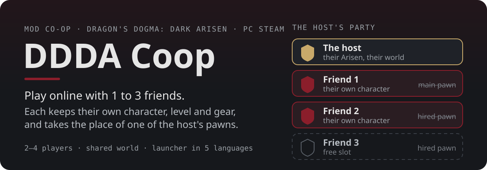
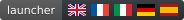
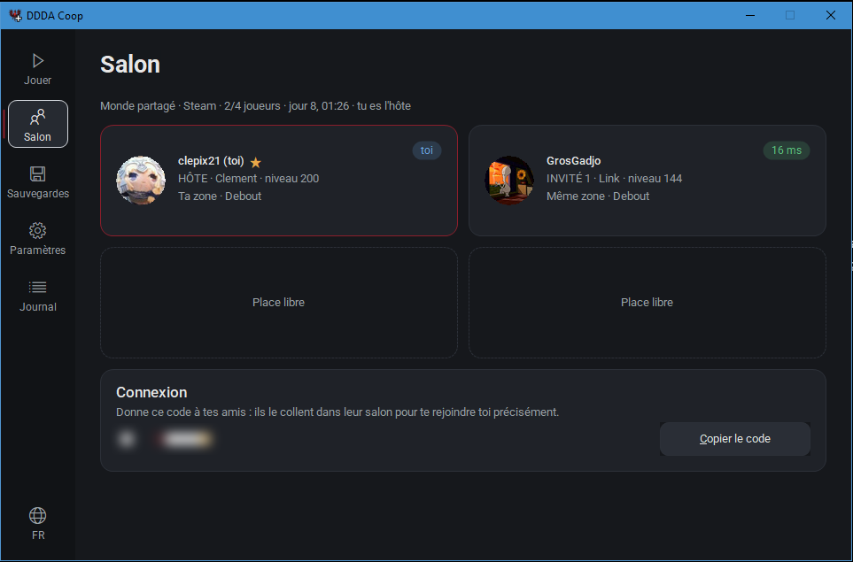
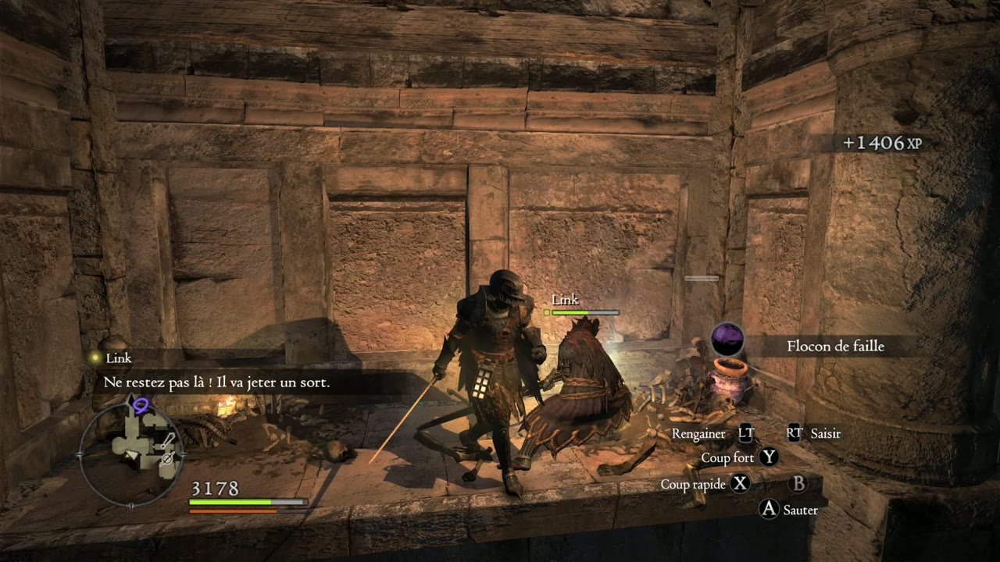
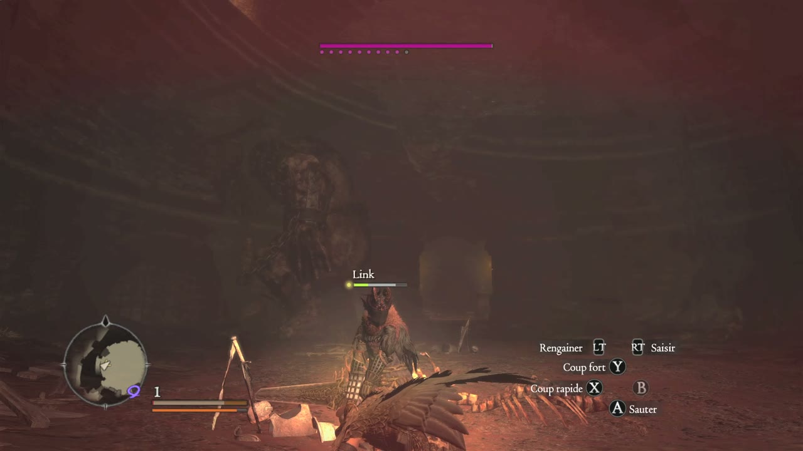
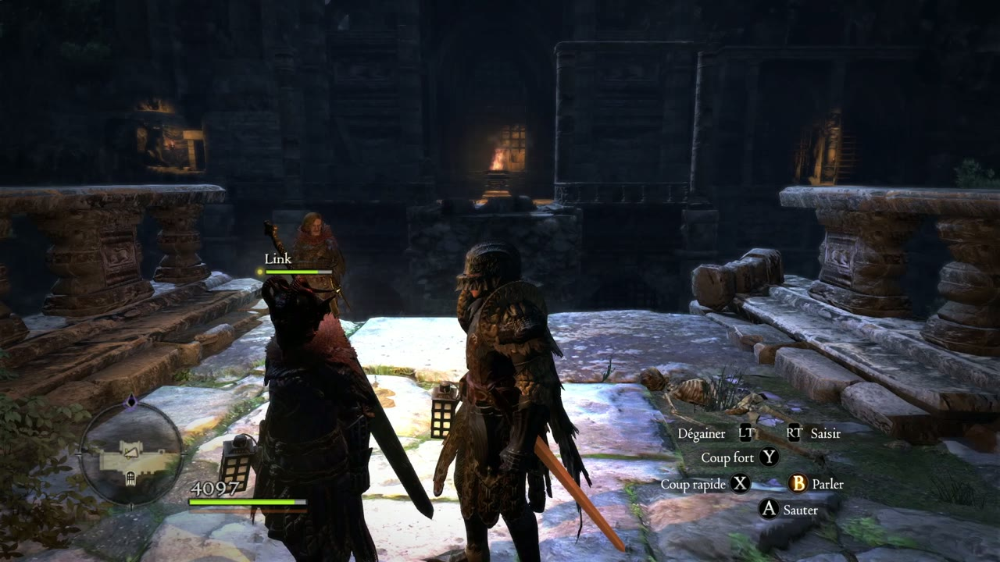
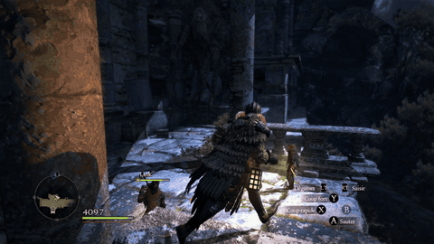
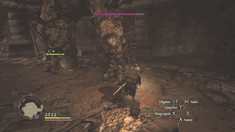
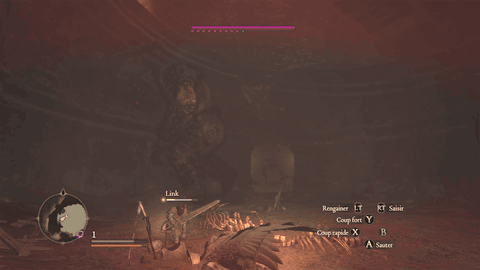
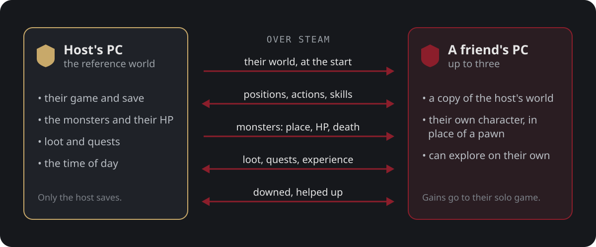

<p align="center">
  
</p>
<p align="center"><b>English</b> · <a href="README.fr.md">Français</a></p>
<p align="center">
  <a href="https://github.com/clepix21/ddda-coop/releases/latest"><b>Download</b></a> ·
  <a href="#install">Install</a> ·
  <a href="#play">Play</a> ·
  <a href="#good-to-know">Good to know</a> ·
  <a href="docs/TECHNICAL.md">Technical docs</a>
</p>

<!-- badges: work/readme_badges.py -->
<p align="center">
  
  
  <a href="https://github.com/clepix21/ddda-coop/releases"></a>
  
  
<br>
  
  
  
  
<br>
  
  
  <a href="LICENSE"></a>
</p>
<!-- /badges -->

<p align="center">
  
  <br><sub>The lobby during a real game (French interface).</sub>
</p>

<p align="center">
  
  
  
</p>
<p align="center">
  
  
  
</p>
<p align="center"><sub>Recorded in a real two-player game (Bitterblack Isle).</sub></p>

## In short

The host plays their game as usual. Up to three friends join (Steam friends, or by IP address on GOG),
each on their own PC and with
**their own character** (look, vocation, level, gear) taking the place of a pawn. Monsters, loot,
quests and experience are shared. What your character earns at a friend's comes back to your solo game.

## How it works

<p align="center">
  
</p>

Only the host saves: a guest's game is never overwritten. Each player can also go off exploring on
their own and come back whenever they like.

## Install

1. Download `DDDA-Coop-vX.Y.Z.zip` from the [Releases](https://github.com/clepix21/ddda-coop/releases)
   and unzip it anywhere.
2. Open `DDDA-Coop.exe`. It finds the game by itself and backs up your saves before each launch.
3. Choose your role (**Host**, **Guest** or **Solo**), then click **Launch the game**.

You need Dragon's Dogma: Dark Arisen on **Steam** (build 2364871, the current PC version) or on
**GOG** (the current GOG version). Everyone needs **the same version of the mod**: the window warns you
otherwise. Both installed? **Settings** › **Game version**: Steam or GOG.

## Play

**The host** launches the game and loads their save. Their Steam friends who have the mod join by
themselves.

**A guest** launches the game and stays on the title screen until the window shows "Connected!",
then presses Start and loads a game: the host's world is what comes in.

Several friends hosting at the same time? The host opens **Lobby** › **Copy the code**, and the guest
pastes that code in their own **Lobby** before launching.

**On GOG** (no Steam), players join by address: the host opens **Lobby** › **Copy the address** and
sends it; the guest pastes it in their **Lobby** before launching. Same network: nothing else to do.
Over the internet: the host forwards UDP port 27101 to their PC, or everyone uses a VPN that makes a
local network. Keep GOG Galaxy open. A Steam player can join a GOG friend this way too, with
**Settings** › **Play without Steam**.

The controls and the details are in `README.txt` inside the zip; `HOW-TO-TEST.txt` is a short checklist for a first game with friends.

## Good to know

- **After the tutorial only.** Co-op starts once the host and each guest have a character that has
  finished the tutorial, that is, with its main pawn. On a new game, play it alone first.
- **Alpha.** Tested mostly by bots and during one evening with friends. Keep "Detailed log" on
  (Settings) so you can report a bug.
- Other players may still slide a little on an uneven connection (improved in 0.9.2).
- Not tested yet: Death (Bitterblack Isle), deep water, long sessions.
- The game's online features (the Rift, other players' pawns) are not supported by the mod: avoid them
  during a co-op game.

Found a bug? Open an [issue](https://github.com/clepix21/ddda-coop/issues) and attach the log (**Log**
screen › **Export the log**).

<details>
<summary><b>FAQ</b></summary>

**Does it touch my saves?** Before each launch, the window copies your saves to
`Documents\DDDA Coop\Sauvegardes`. A guest's game never saves.

**How do I go back to the normal game?** **Settings** › **Remove the mod**. You can also delete
`dinput8.dll` and `coop.ini` from the game folder.

**Does it work outside Steam?** Yes, on the GOG version, by IP address (since 0.10.0). When loading a
game, the GOG game may show "Connection failed" (GOG's pawn server): press A, the game loads.

</details>

<details>
<summary><b>Build from source</b></summary>

You need Windows, [llvm-mingw](https://github.com/mstorsjo/llvm-mingw) and
[MinHook](https://github.com/TsudaKageyu/minhook) 1.3.4:

```powershell
.\build.ps1 -Toolchain <llvm-mingw folder> -MinHook <minhook folder>
```

The build gives `build\dinput8.dll` (the mod), `build\DDDA-Coop.exe` (the window) and
`build\DDDA-Coop.zip`. How it works and the automated tests are described in
[docs/TECHNICAL.md](docs/TECHNICAL.md).

</details>

## Privacy

DDDA Coop collects nothing: no account, no analytics, no server of its own. What it sends, and where:

- **To the other players of your game only:** what co-op needs (your character's place, actions, health,
  equipment, quests and world changes). On Steam it goes through Steam's own network, between Steam
  friends; on GOG it goes straight to the host's IP address that you typed in.
- **To GitHub:** the launcher asks GitHub (api.github.com) if a newer version is out, and downloads it
  from this repository's releases only if you choose to update.
- **To the Discord app on your PC (Rich Presence):** your vocation, level, the place you are in, host or
  guest, and the number of players, shown on your Discord profile. It goes through the local connection
  to the Discord app, not over the internet by the mod; Discord then shows it as it shows any game.
  Your character's name is never sent. Turn it off in the launcher, or with `discord=0` in `coop.ini`.
- **Nothing else.** The log and the save backups (`Documents\DDDA Coop`) stay on your PC; a log leaves
  it only if you export it and attach it to a bug report yourself.

## Credits

- **clepix21**: author of the mod.
- **GrosGadjo** and **yaybba**: testers.
- Developed with the help of **Claude** (Anthropic).
- [MinHook](https://github.com/TsudaKageyu/minhook) (BSD 2-Clause licence) and the
  [Roboto](https://github.com/googlefonts/roboto-3-classic) font (SIL Open Font License 1.1): their licences are in
  [dist/LICENCES.txt](dist/LICENCES.txt).

## License

[MIT](LICENSE) for the mod's own code. The launcher icon is based on Dragon's Dogma artwork © Capcom and is
not covered by it.

<sub>Unofficial mod, not affiliated with Capcom. Dragon's Dogma: Dark Arisen © Capcom. You need your
own copy of the game: this repository contains no game files.</sub>
