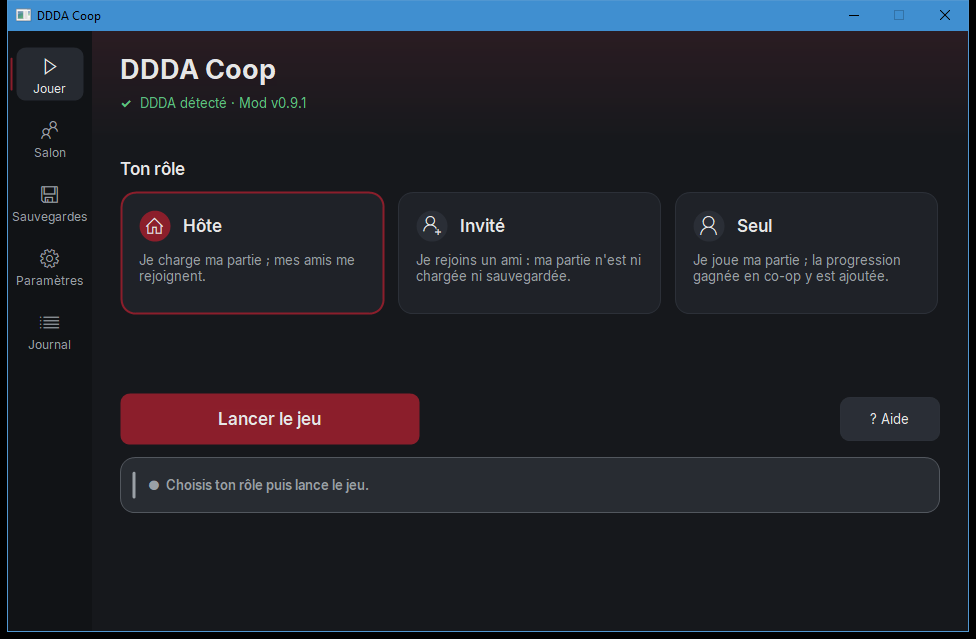

<h1 align="center">DDDA Coop</h1>

<p align="center">
  <b>Le co-op en ligne pour Dragon's Dogma: Dark Arisen.</b><br>
  De 2 à 4 joueurs sur Steam, chacun sur son PC, chacun avec son propre perso.
</p>

<p align="center">
  <a href="https://github.com/clepix21/ddda-coop/releases/latest">Télécharger</a> ·
  <a href="#installation">Installation</a> ·
  <a href="#problèmes-connus">Problèmes connus</a> ·
  <a href="docs/TECHNICAL.md">Documentation technique (en anglais)</a>
</p>

<p align="center"></p>

> **Alpha.** Testé surtout par des bots, et lors d'une première soirée entre amis. Attends-toi à des
> bugs, et garde le « Journal détaillé » activé pour pouvoir les signaler.

## Ce que ça fait

- **Joue ensemble** : l'hôte joue son Insurgé (Arisen) comme d'habitude. Jusqu'à trois amis le
  rejoignent, et chacun prend la place d'un de ses pions.
- **Ton propre perso** : chaque invité arrive avec le sien (apparence, nom, vocation, niveau,
  équipement), tiré de sa propre sauvegarde.
- **Un monde partagé** : ennemis, butin, quêtes et expérience sont synchronisés. Chacun peut partir
  explorer de son côté.
- **Ta progression est gardée** : ce que ton perso gagne chez un ami (expérience, discipline,
  objets) est ajouté à ta partie solo.
- **Rien à configurer** : la fenêtre trouve le jeu, sauvegarde tes parties avant chaque lancement,
  installe le mod et lance le jeu par Steam.
- **Un salon** : photos de profil Steam, niveau et ping de chaque joueur, et un code pour rejoindre
  un ami précis.

## Installation

1. Télécharge le dernier `DDDA-Coop-vX.Y.Z.zip` dans les
   [Releases](https://github.com/clepix21/ddda-coop/releases) et dézippe-le où tu veux.
2. Ouvre `DDDA-Coop.exe`.
3. Choisis ton rôle (**Hôte**, **Invité** ou **Seul**), puis clique sur **Lancer le jeu**.

Tout le monde doit avoir **la même version** du mod. Si ce n'est pas le cas, la fenêtre le dit.

**Prérequis :** Dragon's Dogma: Dark Arisen sur **Steam**, version PC actuelle (build 2364871).
Sur une autre version du jeu, le mod se désactive tout seul.

## Jouer

| | Hôte | Invité |
|---|---|---|
| Avant | Lance le jeu et charge ta partie | Lance le jeu et reste sur l'écran titre |
| Connexion | Les amis Steam qui ont le mod te rejoignent tout seuls | Attends « Connecté ! » dans la fenêtre, puis appuie sur Start |
| Pendant | Tu joues normalement | Tu remplaces un des pions de l'hôte |
| Sauvegarde | Ta partie est sauvegardée normalement | Ta partie n'est jamais écrasée, et tes gains sont gardés pour ta partie solo |

Si plusieurs amis hébergent en même temps : l'hôte ouvre **Salon** et clique sur **Copier le
code**, puis l'invité colle ce code dans son propre **Salon** avant de lancer.

Le fichier `LISEZMOI.txt` du zip détaille tout, touches comprises.

## Problèmes connus

- Avec 3 joueurs, les autres joueurs peuvent glisser ou sauter un peu, et les coups touchent avec
  un léger retard. C'est en cours d'analyse.
- Pas encore testés : les arcs, la Mort (le boss qui rôde la nuit), l'eau profonde, les longues
  sessions.
- Une seule caméra par PC, qui suit ton propre perso. Les cinématiques sont jouées par chaque jeu
  de son côté.
- Les fonctions en ligne du jeu (la Faille, les pions d'autres joueurs) ne sont pas prises en
  charge par le mod. Évite-les pendant une partie en co-op.

Un bug ? Ouvre une [issue](https://github.com/clepix21/ddda-coop/issues) et joins le journal
(écran **Journal** du launcher, bouton **Exporter le journal**).

## Questions fréquentes

**Est-ce que ça touche à mes sauvegardes ?** Avant chaque lancement, la fenêtre copie tes
sauvegardes dans `Documents\DDDA Coop\Sauvegardes`. Le jeu d'un invité ne sauvegarde jamais.

**Comment revenir au jeu normal ?** Ouvre **Paramètres**, puis clique sur **Retirer le mod**. Tu
peux aussi supprimer `dinput8.dll` et `coop.ini` du dossier du jeu.

**Est-ce que ça marche hors de Steam ?** Non pour le moment. Il y a un mode réseau local pour les
tests (voir la documentation technique).

## Compiler depuis les sources

Il faut Windows, [llvm-mingw](https://github.com/mstorsjo/llvm-mingw) et
[MinHook](https://github.com/TsudaKageyu/minhook) 1.3.4 :

```powershell
.\build.ps1 -Toolchain <dossier llvm-mingw> -MinHook <dossier minhook>
```

La compilation donne `build\dinput8.dll` (le mod), `build\DDDA-Coop.exe` (la fenêtre) et
`build\DDDA-Coop.zip`. Le fonctionnement et les tests automatiques sont décrits dans
[docs/TECHNICAL.md](docs/TECHNICAL.md).

## Crédits

- **clepix21** : auteur du mod.
- **GrosGadjo** et **yaybba** : testeurs.
- Développé avec l'aide de **Claude** (Anthropic).
- [MinHook](https://github.com/TsudaKageyu/minhook) (licence BSD 2-Clause) et la police
  [Inter](https://github.com/rsms/inter) (SIL Open Font License 1.1). Les textes de ces licences
  sont dans [dist/LICENCES.txt](dist/LICENCES.txt).

Mod non officiel, sans lien avec Capcom. Dragon's Dogma: Dark Arisen © Capcom. Il te faut ta propre
copie du jeu : ce dépôt ne contient aucun fichier du jeu.
