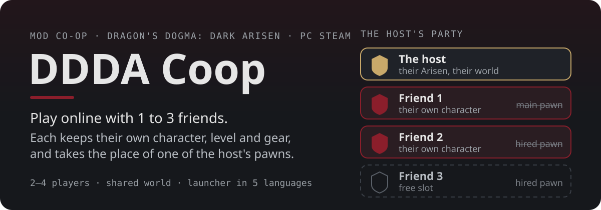
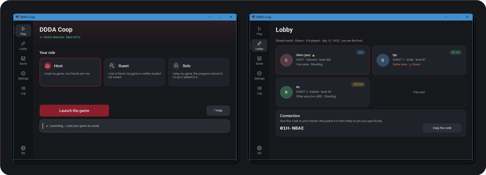
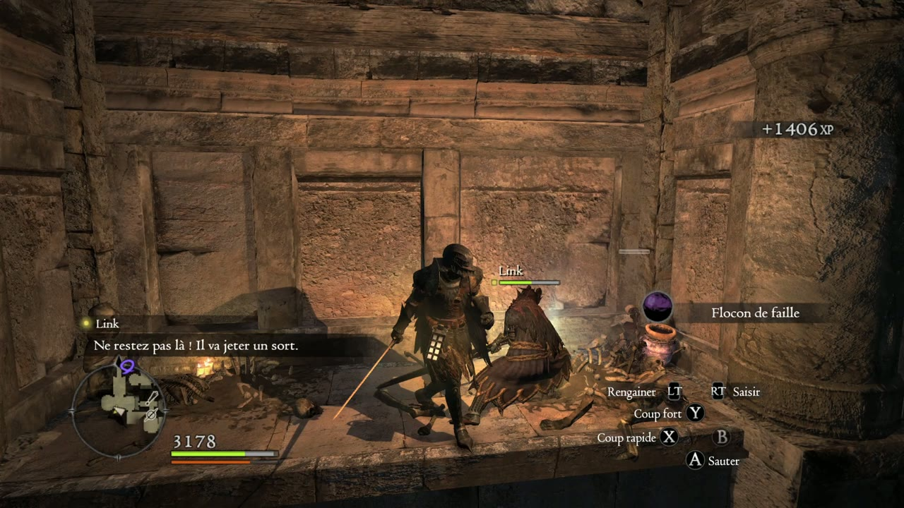
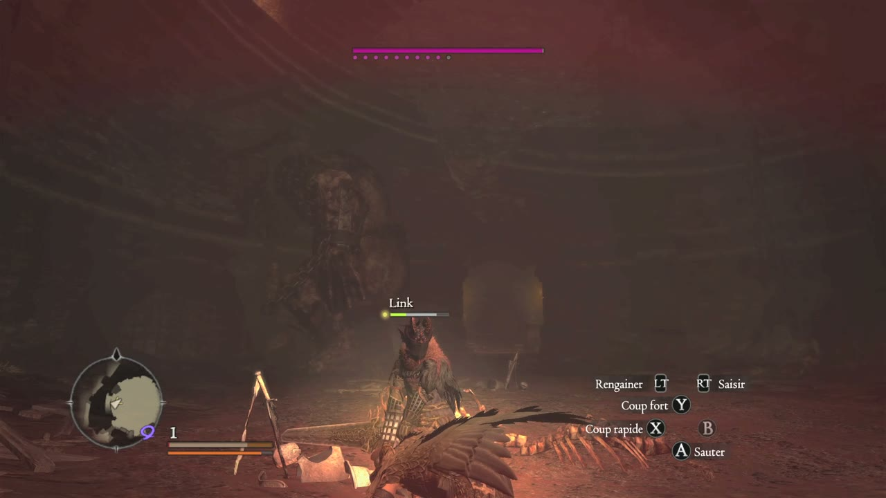
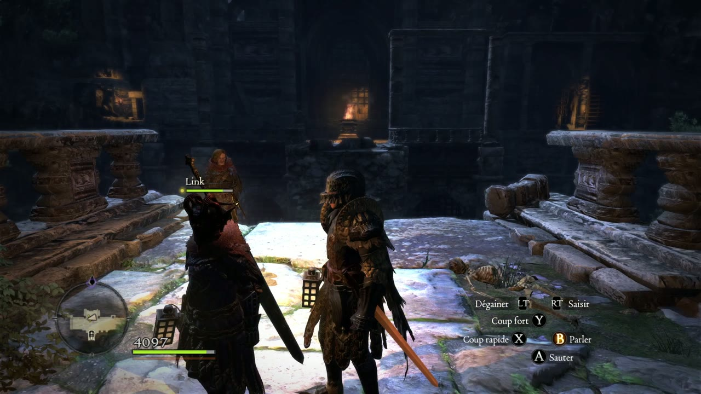
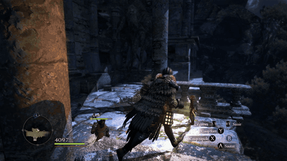
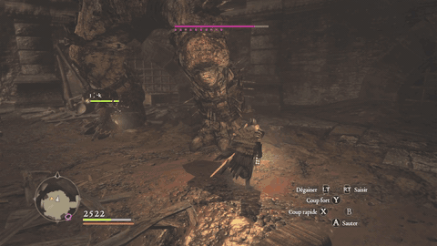
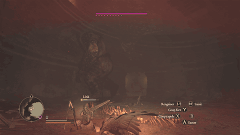
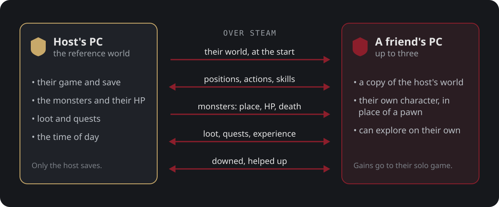

<p align="center">
  
</p>
<p align="center"><b>English</b> · <a href="README.fr.md">Français</a></p>
<p align="center">
  <a href="https://github.com/clepix21/ddda-coop/releases/latest"><b>Download</b></a> ·
  <a href="#install">Install</a> ·
  <a href="#play">Play</a> ·
  <a href="#good-to-know">Good to know</a> ·
  <a href="docs/TECHNICAL.md">Technical docs</a>
</p>

<!-- badges: work/readme_badges.py -->
<p align="center">
  
  
  
  
<br>
  
  
  
<br>
  
  
</p>
<!-- /badges -->

<p align="center">
  
</p>

<p align="center">
  
  
  
</p>
<p align="center">
  
  
  
</p>
<p align="center"><sub>Recorded in a real two-player game (Bitterblack Isle).</sub></p>

## In short

The host plays their game as usual. Up to three Steam friends join, each on their own PC and with
**their own character** (look, vocation, level, gear) taking the place of a pawn. Monsters, loot,
quests and experience are shared. What your character earns at a friend's comes back to your solo game.

## How it works

<p align="center">
  
</p>

Only the host saves: a guest's game is never overwritten. Each player can also go off exploring on
their own and come back whenever they like.

## Install

1. Download `DDDA-Coop-vX.Y.Z.zip` from the [Releases](https://github.com/clepix21/ddda-coop/releases)
   and unzip it anywhere.
2. Open `DDDA-Coop.exe`. It finds the game by itself and backs up your saves before each launch.
3. Choose your role (**Host**, **Guest** or **Solo**), then click **Launch the game**.

You need Dragon's Dogma: Dark Arisen on **Steam** (build 2364871, the current PC version). Everyone
needs **the same version of the mod**: the window warns you otherwise.

## Play

**The host** launches the game and loads their save. Their Steam friends who have the mod join by
themselves.

**A guest** launches the game and stays on the title screen until the window shows "Connected!",
then presses Start and loads a game: the host's world is what comes in.

Several friends hosting at the same time? The host opens **Lobby** › **Copy the code**, and the guest
pastes that code in their own **Lobby** before launching.

The controls and every detail are in `LISEZMOI.txt` (French), inside the zip.

## Good to know

- **After the tutorial only.** Co-op starts once the host and each guest have a character that has
  finished the tutorial, that is, with its main pawn. On a new game, play it alone first.
- **Alpha.** Tested mostly by bots and during one evening with friends. Keep "Detailed log" on
  (Settings) so you can report a bug.
- Other players may still slide a little on an uneven connection (improved in 0.9.2).
- Not tested yet: Death (Bitterblack Isle), deep water, long sessions.
- The game's online features (the Rift, other players' pawns) are not supported by the mod: avoid them
  during a co-op game.

Found a bug? Open an [issue](https://github.com/clepix21/ddda-coop/issues) and attach the log (**Log**
screen › **Export the log**).

<details>
<summary><b>FAQ</b></summary>

**Does it touch my saves?** Before each launch, the window copies your saves to
`Documents\DDDA Coop\Sauvegardes`. A guest's game never saves.

**How do I go back to the normal game?** **Settings** › **Remove the mod**. You can also delete
`dinput8.dll` and `coop.ini` from the game folder.

**Does it work outside Steam?** Not for now. There is a local network mode for tests (see the
technical docs).

</details>

<details>
<summary><b>Build from source</b></summary>

You need Windows, [llvm-mingw](https://github.com/mstorsjo/llvm-mingw) and
[MinHook](https://github.com/TsudaKageyu/minhook) 1.3.4:

```powershell
.\build.ps1 -Toolchain <llvm-mingw folder> -MinHook <minhook folder>
```

The build gives `build\dinput8.dll` (the mod), `build\DDDA-Coop.exe` (the window) and
`build\DDDA-Coop.zip`. How it works and the automated tests are described in
[docs/TECHNICAL.md](docs/TECHNICAL.md).

</details>

## Credits

- **clepix21**: author of the mod.
- **GrosGadjo** and **yaybba**: testers.
- Developed with the help of **Claude** (Anthropic).
- [MinHook](https://github.com/TsudaKageyu/minhook) (BSD 2-Clause licence) and the
  [Roboto](https://github.com/googlefonts/roboto-3-classic) font (SIL Open Font License 1.1): their licences are in
  [dist/LICENCES.txt](dist/LICENCES.txt).

<sub>Unofficial mod, not affiliated with Capcom. Dragon's Dogma: Dark Arisen © Capcom. You need your
own copy of the game: this repository contains no game files.</sub>
